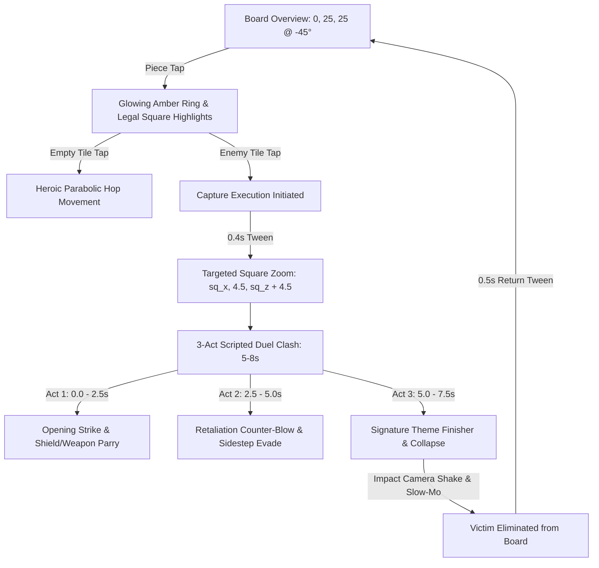

# Project Checkpoint: Duel of Kings (Animated Chess)

**Repository:** `ipock-StLouis-9Ball/battle-chess-reborn`  
**Engine:** Godot 4.x (Universal Mobile & Desktop PBR Pipeline)  
**Status:** In Peak Health (0 Errors, 0 Warnings, 100% Synced)  
**Latest Milestone Commit:** `e613d0b`  
**Date:** October 2026  

---

## 1. Executive Summary & Vision

*Duel of Kings: Animated Chess* is a modern clean-room revival of the iconic 1988 *Battle Chess* experience, engineered from the ground up in Godot 4. The project enforces authentic chess mechanics wrapped in theatrical, animated 3D character clash vignettes.

All extraneous fighting game mechanics (hit points, health bars, damage math, hurtboxes, and virtual joysticks) have been eliminated. In their place is a stationary isometric board with targeted capture zoom, rich articulated 3D character figurines, and the classic Sapphire Blue vs. Crimson Red faction aesthetic.



---

## 2. Core Gameplay & Rule System

1. **Absolute Chess Rules (No Fighting Game Bloat)**:
   - Captures are deterministic: if Piece A takes Piece B's square, Piece B is always eliminated.
   - Zero HP, zero health bars, zero virtual joystick controls.
   - 100% standard chess rules: legal moves, checks, checkmate, stalemate, castling, en passant, and pawn promotion.

2. **Choreographed 3-Act Duel Vignettes (`DuelDirector.gd` & `KillMatrix.gd`)**:
   - **Act 1 (0.0s – 2.5s) Opening Strike**: Attacker lunges forward with weapon; defender parries or braces with shield.
   - **Act 2 (2.5s – 5.0s) Counter-Blow**: Defender retaliates with a counter-attack; attacker ducks, sidesteps, or deflects.
   - **Act 3 (5.0s – 7.5s) Signature Finisher**: Attacker delivers their thematic execution blow; victim collapses; attacker takes the square.
   - **Vignette Conclusion (7.5s – 8.0s)**: Impact screen shake, dynamic slow-motion on hit, and smooth camera return to overview.

3. **3D Raycast Touch-to-Move**:
   - Tapping an owned piece illuminates a soft amber selection ring (`0.5` emission) and highlights legal destination squares.
   - Tapping an empty legal square walks/hops the piece to that square.
   - Tapping an enemy square triggers the square-targeted cinematic capture sequence.

---

## 3. Visual Overhaul & Classic 1988 Faction Palette

### A. Articulated 3D Character Figurines
Primitive cylinders and boxes have been replaced across both `Piece3D.gd` and `tools/generate_3d_assets.py` with multi-part articulated 3D character hierarchies:

| Piece Type | Character Archetype | Anatomical Hierarchy & Equipment |
| :--- | :--- | :--- |
| **Pawn (P)** | Infantry Warrior / Paladin | Armored greaves, steel cuirass, faction tabard, gold buckle, great helm with visor slit, heater shield (left hand), shortsword/spear (right hand). |
| **Rook (R)** | Castle Golem / Colossus | Hulking pillar legs, broad stone/steel torso, crenellated battlement shoulder pauldrons, deep-set head with glowing golem eyes, heavy dual fists & warhammer. |
| **Knight (N)** | Armored Cavalier | Cavalry greaves, steel breastplate & gorget, flowing cape, plumed visored knight helmet with rear-sweeping crest, broadsword, and cavalry kite shield. |
| **Bishop (B)** | High Cleric / Sorcerer | Cascading tiered vestments, embroidered liturgical stole, clerical mitre with gold cross emblem, ornate golden crosier staff with curved crook loop & gem. |
| **Queen (Q)** | Royal Sorceress | Flared royal gown, corseted armor bodice, gold waistband, royal cape, regal head with high 5-pointed gold crown, arcane royal scepter with gem head. |
| **King (K)** | War Monarch | Sweeping royal mantle, fur collar, heavy cuirass with lion crest, gold pauldrons, closed imperial crown with cross finial, two-handed royal greatsword. |

### B. Classic 1988 Palette & PBR Shading
- **Player 1 (Bottom / White)**:
  - Primary Armor: Polished Silver Steel (`Color(0.88, 0.90, 0.94)`, `metallic: 0.82`, `roughness: 0.22`)
  - Secondary / Mantle: Royal Sapphire Blue (`Color(0.12, 0.28, 0.78)`, `metallic: 0.15`, `roughness: 0.55`)
  - Trim / Accents: Imperial Gold (`Color(0.95, 0.80, 0.22)`, `metallic: 0.90`, `roughness: 0.20`)
- **Player 2 (Top / Black)**:
  - Primary Armor: Dark Bronze / Obsidian (`Color(0.18, 0.16, 0.16)`, `metallic: 0.78`, `roughness: 0.32`)
  - Secondary / Mantle: Crimson Ruby Red (`Color(0.75, 0.10, 0.14)`, `metallic: 0.15`, `roughness: 0.55`)
  - Trim / Accents: Antique Gold (`Color(0.85, 0.68, 0.20)`, `metallic: 0.85`, `roughness: 0.25`)
- **Board Squares**:
  - Light Squares: Warm Ivory Stone (`Color(0.93, 0.91, 0.85)`)
  - Dark Squares: Rich Dark Obsidian Marble (`Color(0.11, 0.12, 0.14)`)
  - Contrast: High-contrast contrast allows Sapphire Blue and Crimson Red warriors to pop distinctly from any camera angle.
- **Lighting & Glare Elimination**:
  - ACES Filmic tonemapping (`tonemap_mode = 3`, `tonemap_exposure = 1.0`).
  - Bloom/Glow softened: `glow_intensity = 0.12`, `glow_bloom = 0.04`, `glow_hdr_threshold = 1.05`.
  - Body armor emission disabled (`emission_enabled = false`).
  - Brazier flame energy and omni light energy reduced to `0.6`; tile highlight energy reduced to `0.3`–`0.45`.

---

## 4. Camera & Piece Proportions

1. **Stationary Isometric Overview**:
   - Camera Position: `Vector3(0.0, 25.0, 25.0)`
   - Pitch Angle: `Vector3(-45.0, 0.0, 0.0)` aimed directly at `Vector3(0.0, 0.0, 0.0)`
   - FOV: `38.0°`
   - Framing: Entire 8×8 board (20m), perimeter plinth borders, braziers, and all 32 pieces fit on screen with generous padding on 16:9, foldables, and 4:3 tablets.
2. **Targeted Square Zoom**:
   - Tween: 0.4s cubic ease-out to `Vector3(sq_x, 4.5, sq_z + 4.5)` looking at `Vector3(sq_x, 1.0, sq_z)` at `-45.0°`.
   - Focus: Tightly frames the contested square during the 3-act duel vignette.
   - Return: 0.5s smooth cubic ease-in-out back to `(0, 25, 25)`.
3. **Proportional Piece Scaling (1.8m – 2.6m)**:
   - **Pawn**: `1.80m`
   - **Knight**: `2.05m`
   - **Bishop**: `2.15m`
   - **Rook**: `2.25m`
   - **Queen**: `2.45m`
   - **King**: `2.60m`
   - *Result*: Pieces stand neatly within their 2.5m squares without clipping into or blocking adjacent rows.

---

## 5. Architecture & Codebase Health

### A. Autoload Singletons (Decoupled & Non-Conflicting)
All singletons are registered in `project.godot` without `class_name` headers to prevent cyclic global namespace collisions:

1. `EventBus` (`res://src/autoload/event_bus.gd`)
2. `PlatformManager` (`res://src/autoload/platform_manager.gd`)
3. `SettingsManager` (`res://src/autoload/settings_manager.gd`)
4. `SaveManager` (`res://src/autoload/save_manager.gd`)
5. `AudioManager` (`res://src/autoload/audio_manager.gd`)
6. `GameManager` (`res://src/autoload/game_manager.gd`)
7. `KillMatrix` (`res://scripts/combat/KillMatrix.gd`)
8. `DuelDirector` (`res://scripts/combat/DuelDirector.gd`)
9. `EloCalculator` (`res://scripts/multiplayer/EloCalculator.gd`)
10. `ThemeManager` (`res://scripts/themes/ThemeManager.gd`)

### B. Universal Mobile Layer (`PlatformManager.gd`)
- Removed vendor-specific model sniffing (`SM-*`).
- Universal feature detection via `OS.has_feature("mobile")` / `OS.has_feature("android")`.
- Clean refresh rate detection: `DisplayServer.screen_get_refresh_rate()` with a safe 60 Hz fallback.
- Notch & punch-hole safe area margins dynamically derived via `DisplayServer.get_display_safe_area()`.
- Unified $9.99 Full Game Unlock monetization matching Steam desktop pricing.

### C. Bloat Cleanup
- Deleted unused fighting-game remnants: `src/input/virtual_joystick.gd`, `src/input/virtual_joystick.tscn`, and `src/utils/logger.gd`.
- Removed touch joystick nodes from `src/ui/screens/duel_hud.tscn` and `duel_hud.gd`.

---

## 6. Verification & Audit Results

Running `tools/audit_full_codebase.py`:

```
======================================================================
 Audit Results Summary
======================================================================
  Total Warnings: 0
  Total Errors:   0

ALL AUDIT CHECKS PASSED PERFECTLY! The codebase is in peak health.
```

- **Autoload Integrity**: 10/10 registered, valid, and collision-free.
- **Global Class Names**: 36 unique classes verified.
- **GDScript Syntax**: 46/46 GDScript files passed lexical, indentation, and operator audits.
- **Resource Linkages**: 105/105 resource references validated against disk.
- **3D Asset Pipeline**: 38/38 binary `.glb` meshes generated and verified via `tools/generate_3d_assets.py`.
- **Phone Storage Mirror**: 100% identical copy mirrored to `~/storage/shared/Documents/battle-chess-reborn/` (with `.godot/` cache cleared for clean indexing).

---

## 7. Key File Sitemap

```
battle-chess-reborn/
├── assets/
│   ├── materials/
│   │   ├── mat_board_fantasy.tres     # Warm ivory / obsidian board material
│   │   ├── mat_piece_white.tres       # Player 1 Silver Steel PBR
│   │   └── mat_piece_black.tres       # Player 2 Dark Bronze/Obsidian PBR
│   └── models/
│       ├── fantasy/                   # Binary .glb character meshes (pawn, knight, etc.)
│       ├── cyberpunk/                 # Cyberpunk theme .glb meshes
│       └── eldritch/                  # Eldritch theme .glb meshes
├── scenes/
│   ├── board/
│   │   ├── Board3D.tscn               # Stationary 3D arena & ACES environment
│   │   └── Board3D.gd                 # Board logic, braziers, and tile colliders
│   ├── camera/
│   │   ├── CinematicCamera.tscn       # (0, 25, 25) isometric camera
│   │   └── CinematicCamera.gd         # Overview framing & square zoom tweening
│   ├── pieces/
│   │   ├── Piece3D.gd                 # Articulated character figurine manager & anims
│   │   ├── Piece3D_Pawn.tscn          # Infantry pawn scene (1.80m)
│   │   ├── Piece3D_Knight.tscn        # Armored cavalier scene (2.05m)
│   │   ├── Piece3D_Bishop.tscn        # High cleric scene (2.15m)
│   │   ├── Piece3D_Rook.tscn          # Castle golem scene (2.25m)
│   │   ├── Piece3D_Queen.tscn         # Royal sorceress scene (2.45m)
│   │   └── Piece3D_King.tscn          # War monarch scene (2.60m)
│   └── ui/
│       ├── Main.tscn                  # Main entry screen
│       └── Main.gd                    # Screen router & game initiation
├── scripts/
│   ├── combat/
│   │   ├── DuelDirector.gd            # 3-act capture duel coordinator
│   │   └── KillMatrix.gd              # Character matchup animation data
│   └── themes/
│       ├── PieceTheme.gd              # Theme resource class
│       └── ThemeManager.gd            # Faction color & square palette registry
├── src/
│   ├── autoload/
│   │   ├── event_bus.gd               # Global event dispatcher singleton
│   │   └── platform_manager.gd        # Universal mobile & $9.99 unlock singleton
│   └── chess/
│       └── board/
│           └── chess_board.gd         # Authoritative chess rules & move engine
├── tools/
│   ├── audit_full_codebase.py         # Master static analysis & phone sync tool
│   └── generate_3d_assets.py          # Procedural glTF 2.0 binary asset generator
├── CHECKPOINT.md                      # This checkpoint document
├── project.godot                      # Godot 4 project configuration
└── export_presets.cfg                 # Android & Desktop export profiles ($9.99)
```
